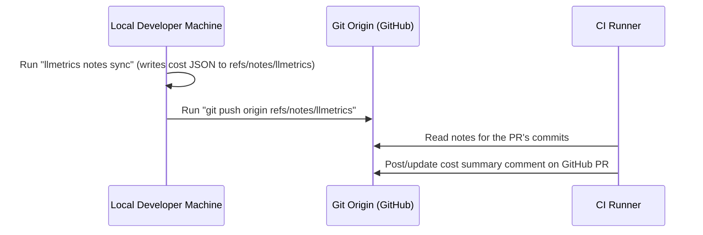

**Git-native cost accounting for AI-assisted repositories — measured, never guessed.**

As software development increasingly integrates AI coding agents (like Claude Code, Codex, and aider), a critical business and development question arises: *What did this feature or commit cost to build?* 

Traditional cloud provider dashboards only give a global API invoice, which doesn't help you attribute cost to features, branches, or PRs. Other tools try to estimate cost from the size of a Git diff, but this is highly inaccurate because diffs miss conversational exploration turns, index parsing, system prompts, and tool execution feedback.

**LLMetrics** resolves this by reading local agent transcripts directly, matching usage events with Git repository history, and calculating the exact dollar costs down to individual commits.


---

## Real World Output

Here is a real example of running `llmetrics log` on LLMetrics's own repository—the tool measuring the cost of its own AI-assisted build process:

```text
  cost  conf  hash     date        subject                                  models          sessions
------  ----  -------  ----------  ---------------------------------------  --------------  --------
$33.24  .     (wip)    2026-07-16  in progress (uncommitted)                claude-fable-5         1
 $5.77  *     87dd80e  2026-07-15  feat(v0.2): gemini-cli source adapter    claude-fable-5         1
$11.03  *     2100e23  2026-07-15  feat(core): on-demand aggregation ro...  claude-fable-5         1
 $7.35  *     cdf2640  2026-07-15  docs: pin gemini/aider adapter contr...  claude-fable-5         1
 $6.32  *     e0dcdf0  2026-07-15  feat(v0.2): codex and aider source a...  claude-fable-5         1
 $6.20  *     9c0af05  2026-07-15  feat(m4): terminal table renderer an...  claude-fable-5         1
 $9.37  *     d847031  2026-07-15  feat(m3): pricing engine — exact big...  claude-fable-5         1
$14.26  *     77442ae  2026-07-15  feat(m2): git layer and attribution ...  claude-fable-5         1
$26.40  *     e1d19ce  2026-07-15  feat(m1): claude-code adapter, incre...  claude-fable-5         1
$10.93  *     fd09c32  2026-07-14  chore: scaffold llmetrics — strict TS...  claude-fable-5         1

totals: $97.63 across 9 commits | waste $2.27 | overhead $0.88 | in progress $33.24
accounting: 6.8B tokens = attributed 29.9M + waste 15.3M + overhead 311.5k + out-of-scope 6.7B OK
```

### Deciphering the Report:
* **Confidence Markers (`conf`)**: In color terminals, these display as ● (high confidence), ◐ (medium confidence), or ○ (low confidence). In ASCII mode (as shown above), they render as `*` (high), `~` (medium), and `.` (low).
* **The Token-Conservation Invariant (`accounting:`)**: LLMetrics enforces a strict ledger check on every single run:
  $$\text{Total Tokens} = \text{Attributed} + \text{Waste} + \text{Overhead} + \text{Out-of-Scope}$$
  Every parsed token must land in exactly one bucket, ensuring the ledger is balanced.

---

## How It Works

1. **Local Parsing**: Coding agents record per-call token usage in local session logs. LLMetrics parses these raw records (rather than estimating based on diff size).
2. **Commit Matching**: It parses the repository's Git history and matches usage events to the commit they most plausibly produced. This matching is done using a scoring heuristic based on:
   * **Edited Files**: Files changed during an agent's conversational turn versus files modified in the Git commit.
   * **Temporal Alignment**: Association with commits made immediately during or after active agent runs.
   * **Branch Context**: Checks active branches to limit search scopes.
3. **Message-Grain Attribution**: Because attribution happens at the message level, a single developer-agent session can split its total cost across several different commits. Conversational exploration turns are charged directly to the code changes they ultimately led to.
4. **Provenance Tiers**: Every calculated number carries a provenance tier:
   * *Measured*: Real tokens calculated at a known price card.
   * *Repriced*: The same traffic calculated on a different model's price card.
   * *Advisory*: Low-confidence attribution.
5. **Privacy by Construction**: LLMetrics reads transcripts read-only and extracts only metadata (timestamps, token counts, model names, session IDs, working directory, branch, and edited-file paths). It never stores or prints prompt/response text, and never connects to the network except for explicit price checks via `--refresh-pricing`.

---

## Supported Agents

| Agent | Log Location | Status |
| :--- | :--- | :--- |
| **Claude Code** | `~/.claude/projects/` *(override with `LLMETRICS_CLAUDE_DIR`)* | Verified against real transcripts |
| **Codex CLI** | `~/.codex/sessions/` *(override with `LLMETRICS_CODEX_DIR`)* | Verified against real transcripts |
| **Gemini CLI** | `~/.gemini/tmp/<project>/chats/` *(override with `LLMETRICS_GEMINI_DIR`)* | Built from source research |
| **aider** | `<repo>/.aider.chat.history.md` | Built from source research |

*Note: **Cursor** is not supported because Cursor's usage data resides on their cloud servers, meaning there are no local logs to measure. LLMetrics refuses to fall back on estimation metrics.*

---

## Commands Reference

| Command | Question Answered / Action Taken |
| :--- | :--- |
| `llmetrics doctor` | Is my environment set up, what logs were found, and how much parsed successfully? |
| `llmetrics summary` | What has AI assistance on this repository cost overall? |
| `llmetrics log [-n N]` | What did each commit cost? *(git log --oneline with dollar costs)* |
| `llmetrics show <ref>` | Where did this commit's cost come from? *(sessions, models, score evidence)* |
| `llmetrics range A..B` | What did this release cost? |
| `llmetrics reprice --model <id>` | What would the same traffic cost if run on another model? |
| `llmetrics report --md` | Write a self-contained Markdown ledger. |
| `llmetrics notes sync` | Annotate commits with cost JSON under `refs/notes/llmetrics` (viewable with `git log --notes=llmetrics`). |
| `llmetrics pr [number]` | What does this GitHub PR cost? *(uses the GitHub CLI `gh`)* |

---

## PR Cost Comments in CI

CI runners do not have your local developer transcripts—the session logs remain strictly on your machine. Therefore, nothing running in CI can measure cost directly. LLMetrics handles this via local measurement and remote relaying:



If no commits in the PR have notes, the workflow completes without posting a comment. You can also post the comment directly from your machine by running `llmetrics pr --comment`.

---

## Honest Limitations

1. **Attribution is Probabilistic**: Joining log events to commits is a scoring heuristic, not ground truth. Low-confidence figures are labeled as *advisory*.
2. **Rebases Orphan Notes**: Git notes annotations key on commit hashes. If you rebase or amend, run `llmetrics notes sync` to re-associate the notes; stale notes on dead hashes remain unreachable and harmless.
3. **Subscription Plans show API-Equivalent Value**: With `--plan pro|max5|max20`, you see what the traffic would have cost at API rates, not what the flat subscription charged you.
4. **Repriced Figures are Counterfactuals**: Repricing runs the exact same token numbers on a different pricing card; a different model might have taken more or fewer turns to complete the same work.
5. **aider and gemini-cli are Approximate**: The adapters were built from source research. Additionally, aider's logs round token counts to roughly two significant figures (e.g., "12k sent").
6. **1-Hour Cache-Write Premium is Unmodeled**: LLMetrics prices all cache writes at the standard 5-minute rate class, which can understate costs on sessions using 1-hour caching.

---

## Project Roadmap

* **Shipped in v0.2**: Codex CLI, Gemini CLI, and aider adapters; the `pr` command; and the PR-comment GitHub Action.
* **Planned for v0.3**:
  * *Churn/Survival Analysis*: Cost per surviving line using git blame sampling.
  * *Cache-Strategy Hints*: Actionable recommendations on when to prompt cache.
  * *TUI Dashboard*: Interactive terminal user interface.
* **Explicitly Never**: Telemetry, hosted-service requirements, or diff-based cost estimation.

---

## Quickstart & Setup

You need Node ≥ 20, a Git repository, and local logs from at least one supported agent. No install, no configuration, no account:

```sh
npx llmetrics doctor
npx llmetrics log
npx llmetrics summary
```

### Other Installation Options:
```sh
# Homebrew (macOS/Linux)
brew tap mikhail0777/llmetrics && brew install llmetrics
```
*Standalone binaries for Linux, macOS, and Windows are attached to each GitHub release.*
